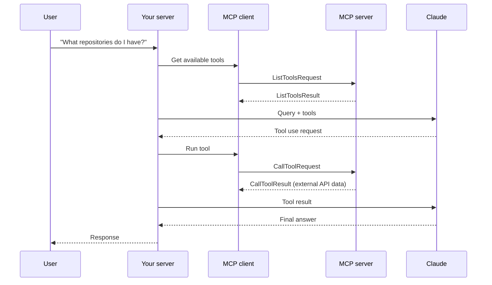
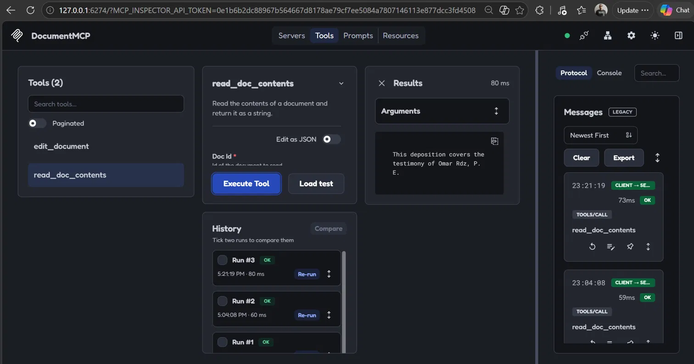

# Introduction to Model Context Protocol

## Prerequisites
- Python 3.14
- uv 0.13 (https://docs.astral.sh/uv/)
- Claude Code 2.1 (to connect the MCP server as a client)

## 1. Welcome to the course
- Goal: build MCP servers and clients in Python using MCP's three primitives: tools, resources and prompts.
- Reference: https://modelcontextprotocol.io/introduction

## 2. Introducing MCP
- MCP is a communication layer that gives Claude context and tools without writing all the integration code yourself.
- Architecture: an MCP client (your app) connects to MCP servers, each exposing tools, prompts and resources for an external service.
- Problem it solves: wrapping a large API (e.g. GitHub) means writing and maintaining many tool schemas and functions; an MCP server already provides them.
- Anyone can author an MCP server; service providers often publish official ones.
- MCP vs. tool use: they are complementary. MCP servers provide ready-made tool definitions and execution; tool use is how Claude calls those tools.

## 3. MCP clients
- The MCP client is the bridge between your app and MCP servers; it handles message exchange and protocol details.
- Transport agnostic: stdio (same machine, most common), HTTP, WebSockets and others.
- Main message types: `ListToolsRequest`/`ListToolsResult` (discover tools) and `CallToolRequest`/`CallToolResult` (run a tool).

## 4. Project setup
- Project: `cli_project`, based on the course reference solution (CLI chat app with an MCP client and an MCP server).
- Dependencies installed with `uv sync`.
- The chat (`main.py`) requires an Anthropic API key in `.env` (pending). The MCP server is tested independently with the MCP Inspector.
- Each lesson documents the relevant code and how it was tested.

## 5. Defining tools with MCP
- Code: `cli_project/mcp_server.py`.
- `FastMCP("DocumentMCP")` creates the server in one line using the official Python SDK.
- Documents are stored in memory in a `docs` dictionary (id -> content).
- Tools are defined with the `@mcp.tool(name, description)` decorator; the SDK generates the JSON schema from type hints and Pydantic `Field` descriptions.
- `read_doc_contents(doc_id)`: returns a document's content, raises `ValueError` if the id does not exist.
- `edit_document(doc_id, old_str, new_str)`: find-and-replace inside a document.
- Benefits: no manual JSON schemas, automatic validation, clear parameter descriptions, errors as normal Python exceptions.
- Tested in the next lesson with the MCP Inspector.

## 6. The server inspector
- Run: `uv run mcp dev mcp_server.py` (from `cli_project`), then open the printed localhost URL and click Connect.
- Tools tab -> List Tools shows `read_doc_contents` and `edit_document`.
- Test: read `deposition.md`, edit "Angela Smith" -> "Omar Rdz", read again to confirm the change.
- The inspector lets you test an MCP server without Claude or an API key.
- Error case: reading `nope.md` returns "Doc with id nope.md not found" (the tool's `ValueError`).
- Server state persists between tool calls, so edits are visible in later reads.

