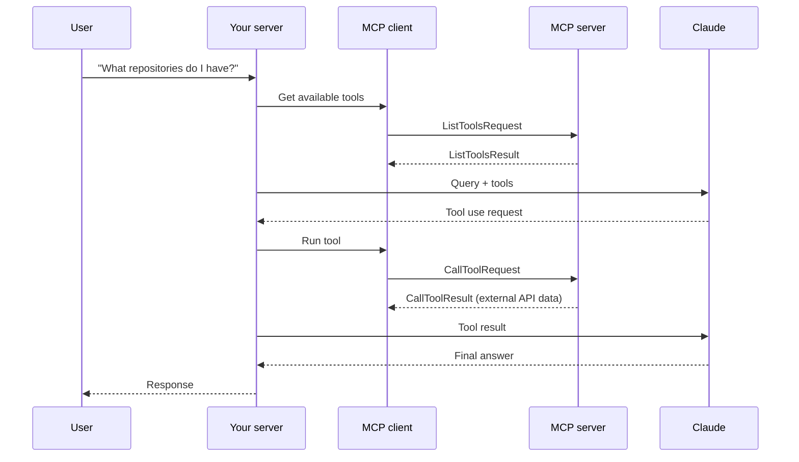
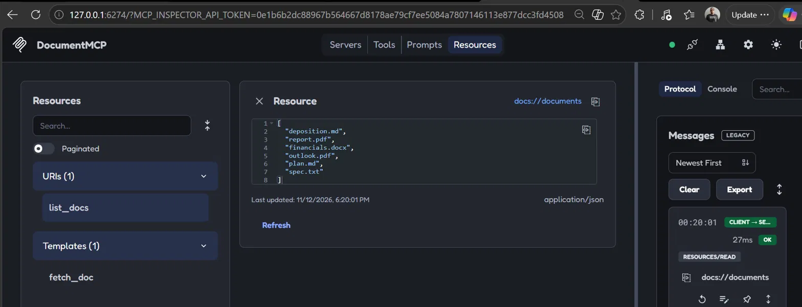
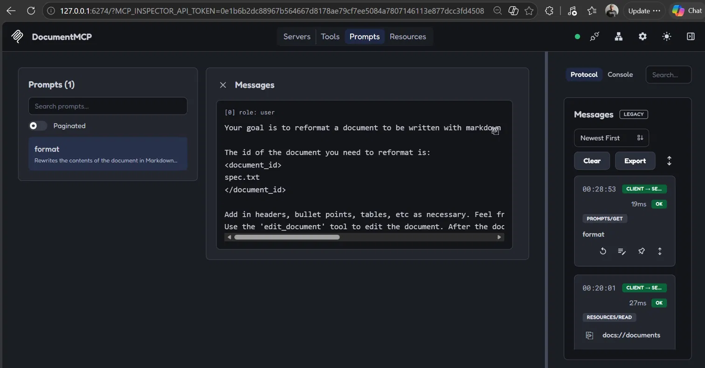

# Introduction to Model Context Protocol

## Prerequisites
- Python 3.14
- uv 0.13 (https://docs.astral.sh/uv/)
- Claude Code 2.1 (to connect the MCP server as a client)

## 1. Welcome to the course
- Goal: build MCP servers and clients in Python using MCP's three primitives: tools, resources and prompts.
- Reference: https://modelcontextprotocol.io/introduction

## 2. Introducing MCP
- MCP is a communication layer that gives Claude context and tools without writing all the integration code yourself.
- Architecture: an MCP client (your app) connects to MCP servers, each exposing tools, prompts and resources for an external service.
- Problem it solves: wrapping a large API (e.g. GitHub) means writing and maintaining many tool schemas and functions; an MCP server already provides them.
- Anyone can author an MCP server; service providers often publish official ones.
- MCP vs. tool use: they are complementary. MCP servers provide ready-made tool definitions and execution; tool use is how Claude calls those tools.

## 3. MCP clients
- The MCP client is the bridge between your app and MCP servers; it handles message exchange and protocol details.
- Transport agnostic: stdio (same machine, most common), HTTP, WebSockets and others.
- Main message types: `ListToolsRequest`/`ListToolsResult` (discover tools) and `CallToolRequest`/`CallToolResult` (run a tool).

## 4. Project setup
- Project: `cli_project`, based on the course reference solution (CLI chat app with an MCP client and an MCP server).
- Dependencies installed with `uv sync`.
- The chat (`main.py`) requires an Anthropic API key in `.env` (pending). The MCP server is tested independently with the MCP Inspector.
- Each lesson documents the relevant code and how it was tested.

## 5. Defining tools with MCP
- Code: `cli_project/mcp_server.py`.
- `FastMCP("DocumentMCP")` creates the server in one line using the official Python SDK.
- Documents are stored in memory in a `docs` dictionary (id -> content).
- Tools are defined with the `@mcp.tool(name, description)` decorator; the SDK generates the JSON schema from type hints and Pydantic `Field` descriptions.
- `read_doc_contents(doc_id)`: returns a document's content, raises `ValueError` if the id does not exist.
- `edit_document(doc_id, old_str, new_str)`: find-and-replace inside a document.
- Benefits: no manual JSON schemas, automatic validation, clear parameter descriptions, errors as normal Python exceptions.
- Tested in the next lesson with the MCP Inspector.

## 6. The server inspector
- Run: `uv run mcp dev mcp_server.py` (from `cli_project`), then open the printed localhost URL and click Connect.
- Tools tab -> List Tools shows `read_doc_contents` and `edit_document`.
- Test: read `deposition.md`, edit "Angela Smith" -> "Omar Rdz", read again to confirm the change.
- The inspector lets you test an MCP server without Claude or an API key.
- Error case: reading `nope.md` returns "Doc with id nope.md not found" (the tool's `ValueError`).
- Server state persists between tool calls, so edits are visible in later reads.

## 7. Implementing a client
- Code: `cli_project/mcp_client.py`.
- Two parts: `ClientSession` (SDK connection to the server) wrapped in a custom `MCPClient` class that handles connection cleanup.
- `list_tools()`: calls `session.list_tools()` and returns the tools (sent to Claude).
- `call_tool(tool_name, tool_input)`: calls `session.call_tool()` with the arguments Claude provides.
- Updated the test harness in `main()` to print each tool's name, description and input schema (it originally only connected).
- Test: `uv run mcp_client.py` starts the server over stdio and prints both tools with their generated JSON schemas.
- Full flow with Claude (`uv run main.py`, "What is the contents of the report.pdf document?") pending: requires API key.

## 8. Defining resources
- Resources expose read-only data, similar to GET handlers in an HTTP server.
- Flow: client sends `ReadResourceRequest` with a URI, server returns `ReadResourceResult`.
- Direct resource (static URI): `docs://documents` returns the list of document ids (`application/json`).
- Templated resource (URI with parameters): `docs://documents/{doc_id}` returns a document's content (`text/plain`); the SDK parses `doc_id` and passes it as a keyword argument.
- `mime_type` hints the data type to the client; the SDK serializes return values automatically.
- Use case: `@document` mentions inject the document content into the prompt without Claude calling a tool.
- Test: MCP Inspector, Resources tab (`docs://documents`) and Resource Templates (`docs://documents/report.pdf`).

## 9. Accessing resources
- Code: `read_resource(uri)` in `cli_project/mcp_client.py`.
- Sends a `ReadResourceRequest` with `AnyUrl(uri)` and takes the first item of `result.contents`.
- If the MIME type is `application/json`, the text is parsed with `json.loads`; otherwise the raw text is returned.
- In the CLI, typing `@` lists documents (autocomplete) and injects the selected document's content into the prompt, so Claude does not need a tool call.
- Test: extended the harness in `main()`; `docs://documents` returns a Python `list` (parsed JSON) and `docs://documents/plan.md` returns a `str`.
- Testing `@` mentions in the chat is pending: requires API key.

## 10. Defining prompts
- Prompts are pre-built, tested instructions that the server author provides so users get better, consistent results.
- Defined with `@mcp.prompt(name, description)`; the function returns a list of messages (`base.UserMessage`, can also include assistant messages).
- Example: `format(doc_id)` asks Claude to rewrite a document in Markdown using the `edit_document` tool. In the CLI it is used as `/format doc_id`.
- Benefits: consistency, encoded domain expertise, reusable across clients, maintained in one place.
- Test: MCP Inspector, Prompts tab, `format` with `doc_id = spec.txt` shows the user message with the id interpolated.

## 11. Prompts in the client
- Code: `list_prompts()` and `get_prompt(prompt_name, args)` in `cli_project/mcp_client.py`.
- `list_prompts()` returns the prompts the server defines; in the CLI they appear as `/` commands.
- `get_prompt("format", {"doc_id": "plan.md"})`: the args dict becomes keyword arguments of the server's prompt function and the interpolated messages are returned, ready to send to Claude.
- Claude then uses the server's tools (e.g. `edit_document`) to complete the task.
- Test: extended the harness in `main()` to list prompts and print the messages returned for `format` with `plan.md`.
- Testing `/format` in the chat is pending: requires API key.

## 12. MCP review

| Primitive | Controlled by | Use it to | In this project |
|---|---|---|---|
| Tools | Model (Claude) | Give Claude new capabilities it uses autonomously | `read_doc_contents`, `edit_document` |
| Resources | App (your code) | Get data into the app for UI or context | `docs://documents` (autocomplete), `docs://documents/{doc_id}` (`@` mentions) |
| Prompts | User | Predefined workflows triggered on demand | `/format doc_id` |

- Tools serve the model, resources serve the app, prompts serve the user.

## Status
- Completed: server (tools, resources, prompts) and client functions, tested with the MCP Inspector and the client test harness.
- Pending (requires API key): running the full chat with Claude (`uv run main.py`).
